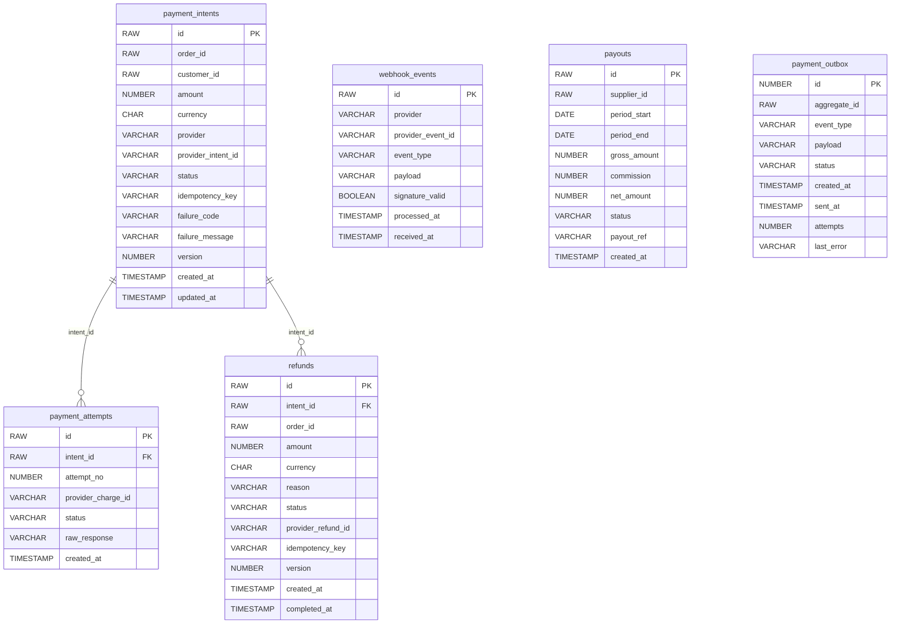

# ShopTrail Payment Service

Payments for ShopTrail: payment intents, Stripe and Razorpay (test mode), refunds, webhooks and reconciliation.

Part of **ShopTrail**, a multi-seller marketplace. Full system reference: [`marketplace_tdd.md`](https://github.com/RaghuMHulkoti/inventory-manager/blob/main/marketplace_tdd.md).

| | |
|---|---|
| Live | https://payment-service-iyeh.onrender.com |
| Swagger UI | https://payment-service-iyeh.onrender.com/swagger-ui.html |
| Health | https://payment-service-iyeh.onrender.com/actuator/health |
| Local port | `8085` |
| Database | Oracle Autonomous DB, schema `PAYMENT` (Flyway) |
| Stack | Java 25, Spring Boot 4.1, Spring Data JPA, Flyway, Spring Kafka, stripe-java, Razorpay REST API |

## Responsibilities

- Create a payment intent per order attempt when order-service asks (`PAYMENT_REQUESTED`).
- Charge with Stripe (token) or Razorpay Standard Checkout (browser modal, signature verified on the server).
- Refunds, including automatic refunds for money captured on an order that already ended.
- Cancel open intents when an order is cancelled or failed.
- Webhooks from Stripe and Razorpay, and periodic reconciliation of stuck intents.

## How it fits

- Kafka: consumes `domain.order.events`, produces `domain.payment.events`.
- REST in from order-service: confirm intent, status, refund (`/api/v1/internal/**`).
- REST in from the order console: Razorpay checkout data and signature verification.

## Run locally

Prerequisites: JDK 25+, Maven wrapper (included), the Oracle wallet of the shared database; Stripe and Razorpay **test** keys if you want real provider calls (without them payments are simulated).

```bash
export DB_PASSWORD=...                       # Oracle password (never commit it)
export WALLET_DIR=/path/to/Wallet_ECOMMERCE  # unzipped Oracle wallet
./mvnw spring-boot:run
```

For local runs, put provider keys in a git-ignored `.env` file in this folder; `spring.config.import` loads it:

```properties
STRIPE_SECRET_KEY=sk_test_...
RAZORPAY_KEY_ID=rzp_test_...
RAZORPAY_KEY_SECRET=...
```

Open http://localhost:8085/swagger-ui.html.

### Tests

```bash
./mvnw test
```

Tests run on H2 in Oracle mode with fake providers; no database, broker or provider keys needed.

### Docker

```bash
docker build -t shoptrail-payment-service .
docker run -p 8085:8085 -e DB_PASSWORD=... -e WALLET_CWALLET_B64="$(base64 < cwallet.sso)" shoptrail-payment-service
```

`docker-entrypoint.sh` unpacks the wallet from `WALLET_CWALLET_B64` when it is set.

## Configuration

All settings come from environment variables. Secrets have no defaults and must never be committed.

| Variable | Default | Purpose |
|---|---|---|
| `KAFKA_BOOTSTRAP_SERVERS` | `production-fgivv4.eu.cluster.ntail.io:9092` | Kafka cluster address |
| `KAFKA_SECURITY_PROTOCOL` | `SASL_SSL` | `SASL_SSL` for the cloud cluster, `PLAINTEXT` for a local broker |
| `KAFKA_USERNAME` | `default` | SASL/PLAIN user |
| `KAFKA_PASSWORD` | _(none, secret)_ | SASL/PLAIN password. Secret |
| `WALLET_DIR` | a local path | Folder of the Oracle wallet (local runs). On Render set `WALLET_CWALLET_B64` instead |
| `DB_USERNAME` | `ADMIN` | Oracle user |
| `DB_PASSWORD` | _(none, secret)_ | Oracle password. Required, no default |
| `SERVER_PORT` | `8085` | HTTP port |
| `EVENTS_PUBLISHER` | `log` | `log` prints events; `kafka` publishes them |
| `EVENTS_CONSUMER_ENABLED` | `false` | `true` starts the Kafka listeners |
| `EVENTS_CREATE_TOPICS` | `true` | Create this service's topics at startup |
| `STRIPE_WEBHOOK_SECRET` | _(none, secret)_ | Stripe webhook signing secret. Webhooks rejected while empty. Secret |
| `STRIPE_SECRET_KEY` | _(none, secret)_ | Stripe key, test mode `sk_test_...`. Empty = simulated payments. Secret |
| `RAZORPAY_WEBHOOK_SECRET` | _(none, secret)_ | Razorpay webhook secret. Secret |
| `RAZORPAY_KEY_ID` | _(empty)_ | Razorpay key id (`rzp_test_...`), shared with the browser checkout |
| `RAZORPAY_KEY_SECRET` | _(none, secret)_ | Razorpay key secret. Never sent to the browser. Secret |
| `OTEL_EXPORTER_OTLP_ENDPOINT` | `http://localhost:4318` | OTLP endpoint for metrics push (active only with `OTEL_METRICS_EXPORTER=otlp`) |
| `OTEL_SERVICE_NAME` | application name | `service.name` resource attribute |
| `CORS_ALLOWED_ORIGINS` | _(empty)_ | Comma-separated browser origins allowed to call the API. Empty = none. No trailing dot or slash |

## API

Responses are wrapped as `{"status", "message", "body"}`. Only test keys are used; no real money moves.

| Method | Path | Purpose |
|---|---|---|
| GET | `/api/v1/payments/{id}` | Payment intent status |
| GET | `/api/v1/payments/{id}/checkout` | Razorpay Checkout data (provider order id, public key id, amount) |
| POST | `/api/v1/payments/{id}/razorpay/verify` | Verify Razorpay payment signature |
| POST | `/api/v1/internal/payments/intents` | Create intent (used by order) |
| POST | `/api/v1/internal/payments/intents/{id}/confirm` | Confirm intent with a token (used by order) |
| POST | `/api/v1/internal/payments/refunds` | Refund (used by order) |
| POST | `/api/v1/webhooks/stripe` | Stripe webhook (signature checked) |
| POST | `/api/v1/webhooks/razorpay` | Razorpay webhook (signature checked) |

## Data model

Schema `PAYMENT`. Full columns and constraints: [section 8 of the reference](https://github.com/RaghuMHulkoti/inventory-manager/blob/main/marketplace_tdd.md#8-data-model).



| Table | Holds | Created in |
|---|---|---|
| `payment_intents` | One intent per order attempt, provider ids and status | `V1__create_payment_schema.sql` |
| `payment_attempts` | Every charge attempt with provider response | `V1__create_payment_schema.sql` |
| `refunds` | Refunds per intent | `V1__create_payment_schema.sql` |
| `webhook_events` | Received webhooks (deduplicated by provider event id) | `V1__create_payment_schema.sql` |
| `payouts` | Supplier payouts (not used yet) | `V1__create_payment_schema.sql` |
| `payment_outbox` | Events waiting to be published | `V1__create_payment_schema.sql` |

## Events

**Consumes** `domain.order.events`: `PAYMENT_REQUESTED` creates an intent; `ORDER_CANCELLED` and `ORDER_FAILED` cancel open intents. Failures retry three times and then go to `domain.order.events.dlq`.

**Publishes** to `domain.payment.events` (keyed by order id): `PAYMENT_INITIATED`, `PAYMENT_SUCCESS`, `PAYMENT_FAILED`.

## Background jobs

| Job | Schedule | Does |
|---|---|---|
| `PaymentOutboxPoller` | every 1 s | Publishes pending outbox rows |
| `WebhookProcessorJob` | every 5 s | Applies stored webhooks |
| `ReconciliationJob` | every 15 min | Re-checks intents stuck longer than 1 h with the provider |

## How it works

- **Providers:** Stripe through stripe-java, Razorpay through its REST API. A missing key falls back to a simulated provider.
- **Razorpay checkout:** `GET /payments/{id}/checkout` returns the provider order id and the public key id; the browser opens the modal; `POST /payments/{id}/razorpay/verify` checks the HMAC-SHA256 signature with the key secret.
- **Retries:** provider calls retry 3 times with exponential backoff on transient errors.
- **Idempotency:** unique keys on intents and refunds; webhooks are deduplicated by provider event id.
- **Webhooks** are rejected while their signing secret is empty.

## Deployment

- Render web service (Docker), deployed manually or with `render deploys create <service-id>`.
- Set at least: `DB_PASSWORD`, `WALLET_CWALLET_B64`, `CORS_ALLOWED_ORIGINS` (order console origin), `KAFKA_PASSWORD`, `EVENTS_PUBLISHER=kafka`, `EVENTS_CONSUMER_ENABLED=true`, the Stripe and Razorpay test keys.
- CI: `.github/workflows/maven.yml` runs `mvn test`, builds the image, smoke-tests the container and pushes it to `ghcr.io`.
- Observability: `/actuator/health` (liveness and readiness probes), Prometheus at `/actuator/prometheus`, optional OTLP push.

## Known gaps

- `/api/v1/internal/**` has no authentication yet.
- Payouts to suppliers are not implemented (the table exists).
- Webhook URLs are not registered with the providers yet, so status comes from the API and reconciliation.
